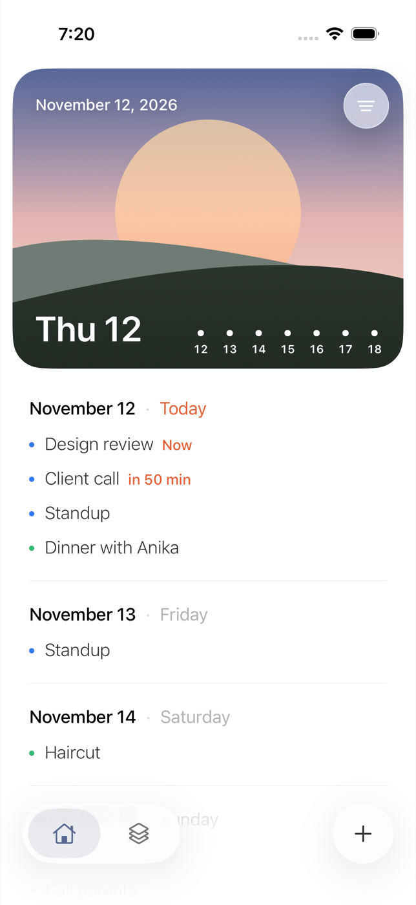
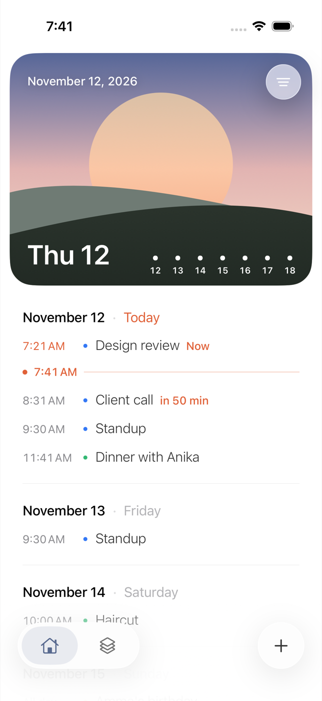
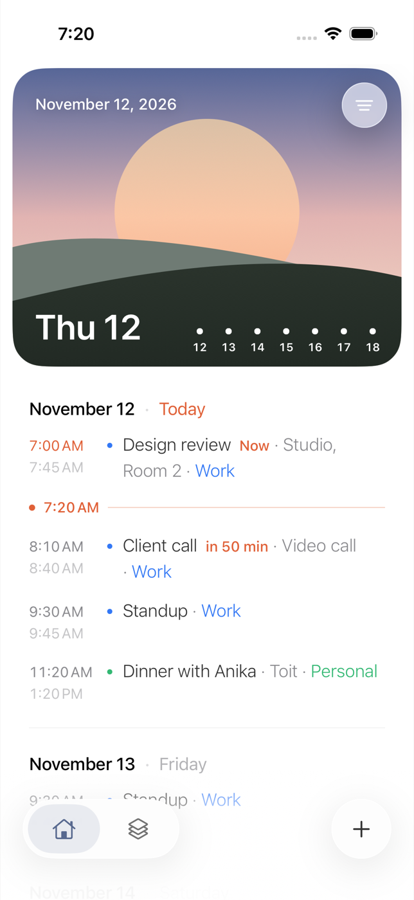
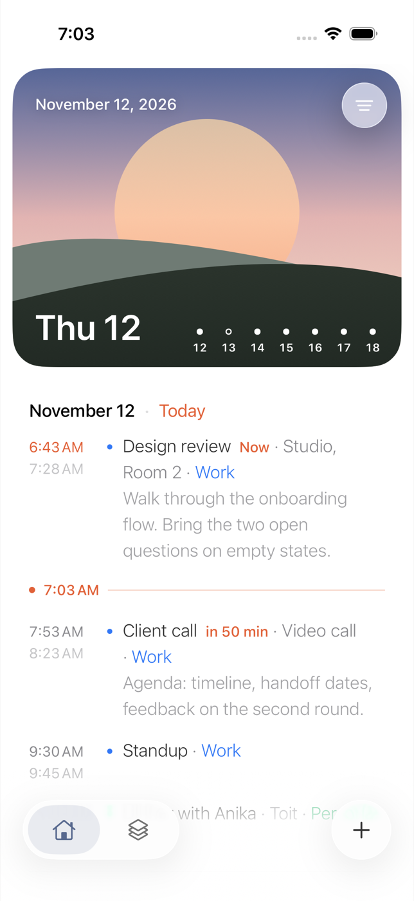

# Strata

A calendar for iPhone built around one idea: your events are a single continuous
timeline, and you spread two fingers on it, the way you would zoom a photo, to make
every event say more.

Strata is a working name. To change it, rename the target in Xcode and update
`PRODUCT_BUNDLE_IDENTIFIER` (currently `com.zaak.strata`).

## The timeline

The text never changes size. Each level adds words to the one before, and they
arrive one at a time under your fingers. Let go and the timeline settles on the
nearest level.

| Level | What each event says |
| --- | --- |
| Titles | Its title |
| Times | Its start time slides in beside the title |
| Details | Adds the end time, place and calendar |
| Notes | Adds the opening of its notes |

| Titles | Times | Details | Notes |
| --- | --- | --- | --- |
|  |  |  |  |

Around it:

- The **hero card** shows today over a sky drawn for the time of day, and the week
  ahead as a strip of dots: filled when a day has events, hollow when it is free.
  Tap a day to jump to it.
- The round button on the card opens **view options**: pick a level without
  pinching (VoiceOver's zoom action does the same), or load earlier events.
- Tap an event to see it in full. Touch and hold for Edit and Delete. Touch and
  hold a date to add an event on that day.
- Today shows what is live: the event in progress is marked "Now", the next one
  shows how soon it starts, and once times are showing a marker sits at the
  current time.
- The floating bar holds two tabs, **Timeline** and **Calendars**, and the add
  button. Tapping Timeline again returns to today.
- The timeline opens on today and runs two years ahead. Earlier events load three
  months at a time.

## Running it

Requires Xcode 26 or later. The app targets iOS 17 and uses Liquid Glass for the
floating controls on iOS 26.

1. Open `ios/Strata.xcodeproj`.
2. Pick an iPhone simulator and press Run.
3. To run on your own iPhone, select the Strata target, open Signing & Capabilities
   and choose your team.

The simulator has almost no calendar data. Tap **Try with sample events** on the
first screen, or add `-demoData` to the scheme's launch arguments, to see a full
timeline.

## How it is put together

```
Strata/
  Models/      Calendar, event and draft types. Timeline grouping. Zoom and word reveal.
  Providers/   CalendarProvider protocol, the Apple Calendar provider, sample data.
  Store/       CalendarStore: the one object the views read from.
  Views/       Timeline, hero card, tabs, calendars, event detail, editor, first run.
StrataTests/     Unit tests for grouping, zoom, word reveal and the store.
StrataUITests/   UI tests, including the pinch, run on sample data.
```

The views never touch EventKit. They read `CalendarStore`, which talks to one or
more `CalendarProvider`s and merges what they return.

### Apple Calendar

`AppleCalendarProvider` uses EventKit with full calendar access. It reads every
calendar set up on the device, so iCloud, Exchange and any Google account added in
iOS Settings already appear, grouped by account. Events can be added, edited, moved
between calendars and deleted. Repeating events ask whether a change applies to
this event or to all future ones.

### Adding Google Calendar

Write a `GoogleCalendarProvider` that conforms to `CalendarProvider` and pass it to
`CalendarStore` next to the Apple one:

```swift
CalendarStore(providers: [AppleCalendarProvider(), GoogleCalendarProvider()])
```

Calendar and event ids are prefixed with the provider's id, so the two can't
collide. The store already merges calendars from several providers, groups them by
account, and handles moving an event from one provider to another. What a Google
provider needs to supply is sign-in (OAuth), the Calendar API calls behind the six
protocol methods, and a call to `onChange` when its data changes.

## Tests

```
xcodebuild test -project ios/Strata.xcodeproj -scheme Strata \
  -destination 'platform=iOS Simulator,name=iPhone 17'
```

The `iOS` GitHub Actions workflow builds the app and runs both test suites on a
macOS runner for every push that touches `ios/`. When a commit message contains
`[screenshots]`, the workflow also saves the UI tests' screenshots to
`ios/docs/screenshots`, which is where the images above come from.
