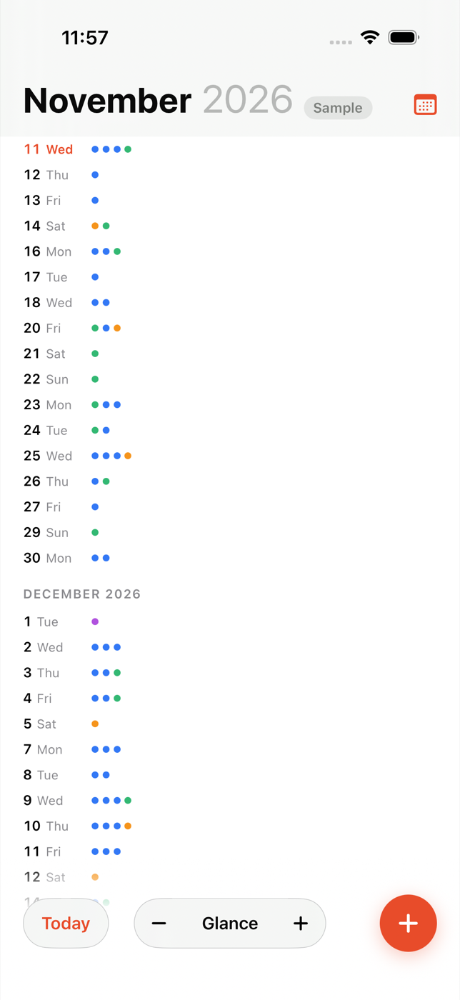
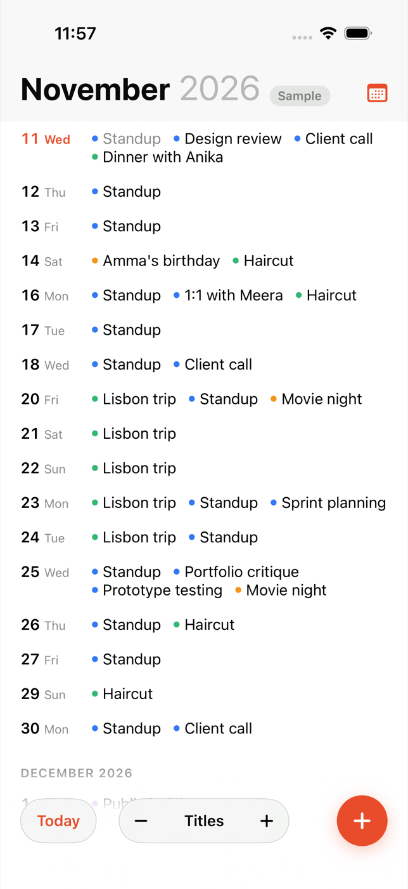
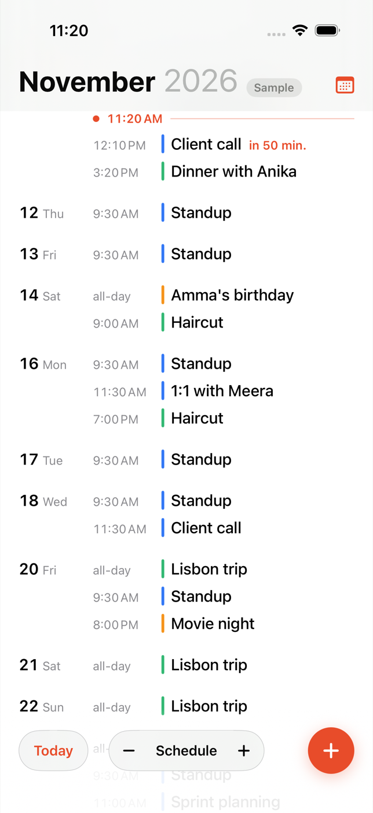
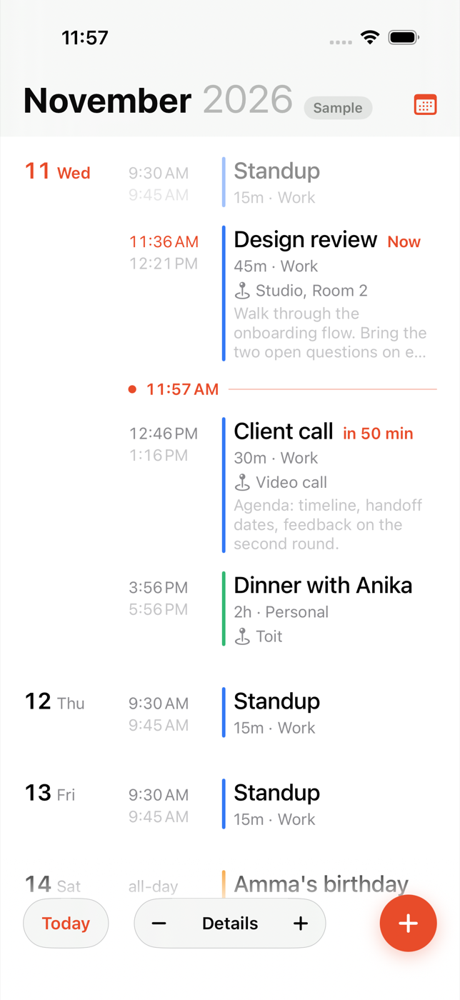

# Strata

A calendar for iPhone built around one idea: your events are a single continuous
timeline, and you pinch it like a photo to choose how much you see.

Strata is a working name. To change it, rename the target in Xcode and update
`PRODUCT_BUNDLE_IDENTIFIER` (currently `com.zaak.strata`).

## The four levels

Pinching scales the text under your fingers. When you let go, the timeline
settles on the nearest level.

| Level | What a day shows |
| --- | --- |
| Glance | The date and one dot per event, colored by calendar |
| Titles | The date and the day's event titles on one flowing line |
| Schedule | One line per event, with its start time |
| Details | Each event with end time, duration, calendar, place and notes |

| Glance | Titles | Schedule | Details |
| --- | --- | --- | --- |
|  |  |  |  |

Other interactions:

- Tap a day at Glance or Titles to open it at Schedule.
- Tap an event to see it in full. Touch and hold for Edit and Delete.
- Touch and hold a date to add an event on that day.
- The **–** and **+** buttons step through the levels without pinching. VoiceOver's
  zoom action does the same.
- Today shows a live marker at the current time. The event in progress is marked
  "Now", and the next one shows how soon it starts.
- The timeline opens on today and runs two years ahead. **Earlier events** at the
  top loads the past, three months at a time.

## Running it

Requires Xcode 16 or later. The app targets iOS 17.

1. Open `ios/Strata.xcodeproj`.
2. Pick an iPhone simulator and press Run.
3. To run on your own iPhone, select the Strata target, open Signing & Capabilities
   and choose your team.

The simulator has almost no calendar data. Tap **Try with sample events** on the
first screen, or add `-demoData` to the scheme's launch arguments, to see a full
timeline.

## How it is put together

```
Strata/
  Models/      Calendar, event and draft types. Timeline grouping. Zoom maths.
  Providers/   CalendarProvider protocol, the Apple Calendar provider, sample data.
  Store/       CalendarStore: the one object the views read from.
  Views/       Timeline, event detail, editor, calendar list, first-run screen.
StrataTests/     Unit tests for grouping, zoom and the store.
StrataUITests/   UI tests, including the pinch, run on sample data.
```

The views never touch EventKit. They read `CalendarStore`, which talks to one or
more `CalendarProvider`s and merges what they return.

### Apple Calendar

`AppleCalendarProvider` uses EventKit with full calendar access. It reads every
calendar set up on the device, so iCloud, Exchange and any Google account added in
iOS Settings already appear, grouped by account. Events can be added, edited, moved
between calendars and deleted. Repeating events ask whether a change applies to
this event or to all future ones.

### Adding Google Calendar

Write a `GoogleCalendarProvider` that conforms to `CalendarProvider` and pass it to
`CalendarStore` next to the Apple one:

```swift
CalendarStore(providers: [AppleCalendarProvider(), GoogleCalendarProvider()])
```

Calendar and event ids are prefixed with the provider's id, so the two can't
collide. The store already merges calendars from several providers, groups them by
account, and handles moving an event from one provider to another. What a Google
provider needs to supply is sign-in (OAuth), the Calendar API calls behind the six
protocol methods, and a call to `onChange` when its data changes.

## Tests

```
xcodebuild test -project ios/Strata.xcodeproj -scheme Strata \
  -destination 'platform=iOS Simulator,name=iPhone 16'
```

The `iOS` GitHub Actions workflow builds the app and runs both test suites on a
macOS runner for every push that touches `ios/`. When a commit message contains
`[screenshots]`, the workflow also saves the UI tests' screenshots to
`ios/docs/screenshots`, which is where the images above come from.
